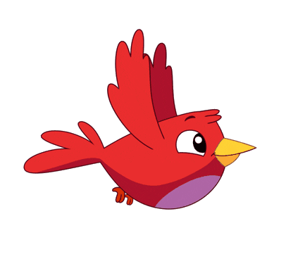

# 🐦 Flappy Bird

**A browser clone of Flappy Bird in vanilla JavaScript, with no libraries.**

## 🎮 Play

Open `flappyBird.html` in your browser and press any key or click to flap. Dodge the pipes and beat your high score.

## 🧠 How it works

- Timer-driven game loop (`setInterval`).
- Constant gravity pulling the bird down, and a jump on each key press.
- Obstacles spawned with random heights that scroll across the screen.
- Collision detection that ends the game.
